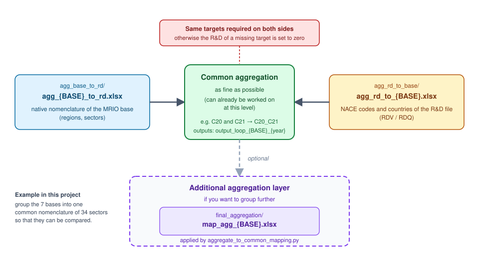

# ENTICE_know_calc

This repository computes the R&D content (direct, embodied, imported) carried by international trade flows, from MRIO databases (EXIOBASE, FIGARO, OECD_ICIO, GTAP) and three additional diffusion channels (CAPITAL, FDI, patent citations). It can be run **without a technology dimension** (R&D by country × sector, written `(c,s)`, or `c_s` in the file and folder names) or **with one** (R&D by country × sector × technology, written `(c,s,t)`, or `c_s_t`).

- the main program: [`code/know_calc_loop.ipynb`](code/know_calc_loop.ipynb)
- the settings: variables at the top of each program (section 2)
- the mapping files: [`mapping/`](mapping)
- the input data: [`input/`](input), with the R&D files in `input/R&D/` (`RDQ_c_s.csv`, `RDV_c_s.csv`, `RDQ_c_s_t.csv`, `RDV_c_s_t.csv`)
- the results (project root): `SRDV_c_s`, `SRDQ_c_s`, `SRDV_c_s_t`, `SRDQ_c_s_t`, and the figures in `graphs_output_loop/`
- two optional programs, described at the end (section 5): the common aggregation and the graphs

## 1. Installation

**1. Adapt the Python version in the `Pipfile`.** Check the version installed on the computer (`py --version`), then, in the `[requires]` section of the `Pipfile`, set that version and delete the `python_full_version` line. Python 3.12 or 3.13 works (the project was tested with 3.13). Example for Python 3.12:

```
[requires]
python_version = "3.12"
```

**2. Open the computer's terminal** (Command Prompt on Windows) and go to the project folder:

```
cd "C:\path\to\ENTICE T3.4"
```

**3. Install `pipenv`, then the virtual environment with the right package versions:**

```
pip install pipenv
py -m pipenv sync
```

Then restart the notebook kernel.

## 2. Configuration

There is no shared settings file: **the variables are defined at the top of each program** (first cell of the notebooks, top of the `.py` script). When several programs are run one after the other, they must be given the **same values**, otherwise the optional programs (section 5) will not find the results of the main program.

| Variable | Where | Role |
|---|---|---|
| `PATH_WRK` | all three programs | project path, to be adapted first on each computer |
| `BASE` | all three programs | database to process |
| `YEARS` | all three programs | years to compute |
| `RD_UNIT`, `DIMENSION` | all three programs | unit and dimension of the R&D |
| `TECHS` | main program, common aggregation | technologies processed in `(c,s,t)` mode |
| `TECH` | graphs | the technology plotted (only one) |
| `METRIC_WANTED` | graphs | `"dir"` or `"embod"` |
| `METRICS_WANTED` | main program (metrics cell, below the first cell) | metrics computed (`"ALL"` = all those of the database) |
| `OUTPUT_TYPE` | main program | what is written for each metric: matrix, vector or both |
| `VERSION_EXIO` | main program | EXIOBASE version downloaded |

Details of the common variables:

- `BASE`: `"EXIOBASE"`, `"FIGARO"`, `"OECD_ICIO"`, `"GTAP"`, `"CAPITAL"`, `"FDI"` or `"Patents_Citation"`. A run processes a single database: to process another one, change `BASE` and run again.
- `YEARS`: list of the years to compute. In `(c,s,t)` mode, it is automatically limited to 2000–2021.
- `RD_UNIT`: `"value"` (`RDV` files, current euros, stocks written `SRDV`) or `"volume"` (`RDQ` files, constant-price euros, stocks written `SRDQ`).
- `DIMENSION`: `"c_s"` (without technology) or `"c_s_t"` (with technology).
- `TECHS`: technologies computed in `(c,s,t)` mode, for example `["TJ11", "TJ07", "TJ01"]` (`"TG*"` = every code starting with TG). About three technologies are recommended: each one is a full computation pass.
- `OUTPUT_TYPE` (main program): `"matrix"` (origin × destination matrix, file `{metric}_{base}_{year}.csv`), `"vector"` (R&D received by each destination (Region, Sector), whatever its origin, i.e. the sum of the matrix over the origins, file `vector_{metric}_{base}_{year}.csv`) or both, `("matrix", "vector")` (default).
- `VERSION_EXIO` (main program): EXIOBASE version downloaded (`"3.11.2"` by default); it selects the mapping file `agg_EXIOBASE_{VERSION_EXIO}_to_rd.xlsx`.

The second cell of the main program checks the values you chose: an unknown database raises an error, and years outside the range available for the database (3.2) trigger a warning.

## 3. The main program: `know_calc_loop.ipynb`

### 3.1 What it does and how to run it

For each year of `YEARS`, it downloads (if needed) and parses the MRIO database, aggregates it with `mapping/agg_base_to_rd/agg_{BASE}_to_rd.xlsx`, computes exports, imports and production, builds the R&D stock (perpetual inventory, 15% depreciation) mapped with `mapping/agg_rd_to_base/agg_rd_to_{BASE}.xlsx`, then computes the metrics below and writes them as CSV. In `c_s_t` mode, the stock and the metrics are recomputed for each technology, while the database is parsed only once per year.

To run it:
1. open `code/know_calc_loop.ipynb` and set the variables of the first cell, and `METRICS_WANTED` in the metrics cell (section 2);
2. check that the input data of the chosen database are in place (3.2);
3. run the cells in order.

GTAP loads very heavy files and may exceed memory (`MemoryError`): close the other programs, restart the kernel, and process only one database at a time.

| Database | Metrics computed | Channel |
|---|---|---|
| EXIOBASE, FIGARO, OECD_ICIO, GTAP | `rd_dir_CI`, `rd_embod_CI`, `rd_imp_CI` | intermediate trade flows |
| CAPITAL | `rd_dir_CAPITAL`, `rd_embod_CAPITAL` | fixed capital stock (Kbar) |
| FDI | `rd_dir_fdips` | foreign direct investment |
| Patents_Citation | `rd_dir_cit` | patent citations |

`rd_dir` is the direct R&D (first tier, with no propagation through the production chain); `rd_embod` is the total embodied R&D (`rd_dir` propagated by the Leontief inverse); `rd_imp` is `rd_embod` restricted to cross-border flows. Each metric is saved as a matrix, a vector or both, depending on `OUTPUT_TYPE`.

### 3.2 Input data

**R&D** (`input/R&D/` folder), chosen by `RD_UNIT` and `DIMENSION`:

| `RD_UNIT` | `DIMENSION` | File | Content |
|---|---|---|---|
| `volume` | `(c,s)` | `RDQ_c_s.csv` | `year;country_code;nace_code;rd_value_volume_M-euro`, `;` separator, 1995–2022, constant-price euros |
| `value` | `(c,s)` | `RDV_c_s.csv` | `year,country_code,nace_code,rd_value_M-euro`, `,` separator, 1995–2022, current euros |
| `volume` / `value` | `(c,s,t)` | `RDQ_c_s_t.csv` / `RDV_c_s_t.csv` | wide format, columns `country_code,sector_code,nace_code,technology_code,group_code`, then one column per year `2000Y1` … `2021Y1` |

`RD_codes_definitions.xlsx`, in the same folder, lists the sector, country and technology codes of these files. The `(c,s,t)` files only cover manufacturing (and `J62_J63`): the other sectors have zero technological R&D. The volumes of a few countries (BR, IN, RU, RO, MX…) seem to be deflated differently there than in `(c,s)`: use with caution.

**MRIO databases and channels** (`input/` folder, locations set by `FOLDER` in the first cell of the main program):

| Database | How to get it | Expected location |
|---|---|---|
| EXIOBASE | automatic | `input/data_EXIOBASE/` (temporary); version set by `VERSION_EXIO` in the notebook |
| FIGARO | automatic | `input/data_FIGARO/` (temporary) |
| OECD_ICIO | **manual** | `input/data_OECD_ICIO/2016-2022_EXT/{year}.csv` |
| GTAP | **manual** | `input/data_GTAP/V12APOW/V12APOW_MRIO_{period}/` (periods 2004, 2007, 2011, 2014, 2017, 2019, 2023; each year uses the closest period) |
| CAPITAL | EXIOBASE (auto) + Kbar (auto, Zenodo 7073276) | `input/data_CAPITAL/Kbar_exio_v3_8_2_{year}_cfc_pxi.mat` (~25 MB per year, downloaded when missing and deleted after use: `KBAR_DELETE_AFTER_USE`) |
| FDI | **manual** | `input/data_FDI/fdi_158_65.har` |
| Patents_Citation | **manual** | `input/data_Patents_Citation/Fractional_Citations_..._prefiltered.csv` |

Years available for each database (checked at the start of the main program): EXIOBASE 1995–2022, FIGARO 2010–2022, OECD_ICIO 2016–2022, CAPITAL 1995–2020, GTAP 1995–2022 (each year uses the closest period), FDI 1995–2022, Patents_Citation 2012–2022. The `input/` folder of the repository only contains the R&D files: the OECD_ICIO, GTAP, FDI and Patents_Citation files have to be placed there by hand, while EXIOBASE, FIGARO and the CAPITAL Kbar files are downloaded.

### 3.3 Outputs

Results go to `<OUTPUT_ROOT>/<BASE>/` (`SRDV_c_s`, `SRDQ_c_s`…). In `(c,s,t)` mode, a subfolder per technology is inserted: `SRDV_c_s_t/<technology>/<BASE>/`.
- `output_loop_{BASE}_{year}/`: one CSV per metric (for example `rd_dir_CI_{BASE}_{year}.csv`), square `(Region, Level, Item)` matrix, `;` separator, at the sector resolution of the database. If `OUTPUT_TYPE` includes `"vector"`, a `vector_{metric}_{base}_{year}.csv` file (one row per destination) is written too.
- `output_loop_{BASE}/`: files with all years as columns, `exports_`, `imports_intermediate_`, `imports_final_demand_` and `production_{BASE}.csv` (EXIOBASE, FIGARO, OECD_ICIO, GTAP, CAPITAL only).

## 4. The mappings (`mapping/`)



The MRIO database (left) and the R&D file (right) are each brought by a first mapping to the same **common aggregation**, as fine as possible (middle). This is the level at which both sides must have exactly the same targets, and it sets the resolution of the results. An **additional aggregation layer** is optional (section 5.1).

| File | Role |
|---|---|
| `agg_base_to_rd/agg_{BASE}_to_rd.xlsx` | converts the database from its native nomenclature to the working nomenclature (read by `mario`); sheets `Sector` (`sector_name (BASE)` → `nace_code (aggregated)`) and `Region` (`region_code (BASE)` → `country_code (aggregated)`); `mario` reads the 1st column as source and the 2nd as target, whatever their titles |
| `agg_rd_to_base/agg_rd_to_{BASE}.xlsx` | converts the 56 NACE codes and the countries of the R&D file to the **same** working nomenclature; sheets `Sector` (`nace_code (RD)` → `nace_code (aggregated)`) and `Region` (`country_code (RD)` → `country_code (aggregated)`) |
| `final_aggregation/map_agg_{BASE}.xlsx` | optional: converts the working nomenclature to the 34 sectors common to the 7 databases (section 5.1) |

The main program finds these files through the `AGG_FILES` and `MAP_RD_FILES` dictionaries in the first cell of `know_calc_loop.ipynb`. The other files in `mapping/` (GTAP before and after 2007, FDI, citations, Kbar for CAPITAL, `Mapping_Ind_prod.xlsx`, `map_capital_iso.xlsx`) are specific to one database and read by the same notebook.

**The rule to follow:** for a given database, the target **sectors** of `agg_{BASE}_to_rd.xlsx` and `agg_rd_to_{BASE}.xlsx` must be strictly identical. A target present on one side only sets the corresponding R&D to zero, without any warning. For regions, the R&D file may have more than the database (their R&D is lost), but a region of the database missing from the R&D file will get no R&D.

**Creating or updating the mappings of a database:**
1. list the native regions and sectors of the database (for example by parsing it with `mario`) and the NACE codes of the R&D file;
2. in `agg_{BASE}_to_rd.xlsx` (copy an existing file as a template), fill in the `nace_code (aggregated)` column of the `Sector` sheet and `country_code (aggregated)` of the `Region` sheet: the aggregation must be the finest one common to both nomenclatures;
3. in `agg_rd_to_{BASE}.xlsx`, fill in `nace_code (aggregated)` and `country_code (aggregated)` for each NACE code and each country of the R&D file, with **exactly the same target labels** as in step 2 (countries absent from the database go to `RW`);
4. declare the file in `AGG_FILES` and `MAP_RD_FILES` of the main program if its name has changed or if the database is new.

## 5. Optional programs

These two programs are not needed for the computation: they use the results of the main program.

### 5.1 Common aggregation: `code/aggregate_to_common_mapping.py`

Groups the matrices (and the `vector_...` files) produced by the main program onto a sector nomenclature common to the 7 databases (34 sectors), with `mapping/final_aggregation/map_agg_{BASE}.xlsx`, so that the databases can be compared with each other. Each result is written next to the original file with the `_agg` suffix (for example `rd_dir_CI_EXIOBASE_2015_agg.csv`); nothing is overwritten. As the matrices are already weighted by R&D intensity, summing rows or columns creates no bias. Run it after the main program, with the same `BASE`, `RD_UNIT`, `DIMENSION` and `TECHS` set at the top of the script:

```
py -m pipenv run python code/aggregate_to_common_mapping.py
```

### 5.2 Graphs: `code/graphs_output_general.ipynb`

Draws flow diagrams (Sankey) and origin decompositions from the output matrices. It scans all available *runs* (value or volume, with or without technology) and displays their catalogue at startup. By default it uses the run defined by `RD_UNIT`, `DIMENSION` and `TECH` at the top of the notebook; to plot another one, change these variables or `DEFAULT_RUN`:

```python
DEFAULT_RUN = run_id("volume", "c_s_t", "TJ07")   # volume, technology TJ07
```

To compare several runs on the same graph, add the run as the 4th element of each source of `plot_origin_decomposition_panels`, for example `("EXIOBASE", "rd_dir_CI", 2010, run_id("value", "c_s"))`. `USE_AGG = True` reads the `_agg` files instead of the matrices at each database's own resolution. The figures are written to `graphs_output_loop/<run>/graphs_output_loop/` (or `graphs_output_loop/comparison/graphs_output_loop/` for a comparison).
